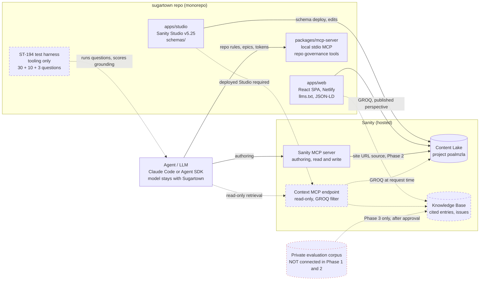

# ST-194 + Sanity Context: Prototype Brief

**Status:** Draft
**Date:** 2026-11-23
**Owner:** Bex Head
**Epic:** [ST-194](../backlog/ST-194-prototype-grounded-cited-answers-private-corpus.md) (issue #194)
**Parent PRD:** [north-star-ontology-second-brain-prd.md](north-star-ontology-second-brain-prd.md), Open Decision 2
**Project ID:** N/A — a prototype input to an existing epic, not a project
**Source:** https://www.sanity.io/context and https://www.sanity.io/docs/context/introduction, read 2026-11-23. Every claim about Context below is from those pages and is **unverified by test** until the claims table in section 6 says otherwise.

---

## 1. Recommendation: test it, in a bounded first pass on public content only

**Add Sanity Context to ST-194 as a fifth retrieval candidate and run a time-boxed test on the public Sugartown dataset first.** The first pass costs nothing (free tier), touches no schema, query or component, and answers the part of Open Decision 2 that matters most: whether a hosted, read-only, cited retrieval layer meets the grounding bar without Sugartown building one.

Do not upload the private evaluation corpus to Context until Bex has made a separate data-handling decision (section 5, risk R1). The private corpus is the reason ST-194 exists, and sending it to a third-party host is a confidentiality call, not a test setup step.

| Phase | What | Corpus | Cost | Go condition |
|---|---|---|---|---|
| 1 | Dataset-mode endpoint, GROQ-filtered to published public document types | Sugartown public dataset | Free | Starts now |
| 2 | Knowledge Base built from the public site URL and `llms.txt`, compared with Phase 1 | Public site | Free (1 KB, 10,000 chunks) | Phase 1 shows promise |
| 3 | Tiered test with one endpoint or KB per confidentiality tier | Private evaluation corpus | $299/month for one month if more than 1 KB is needed (unverified) | Bex approves data handling |

## 2. What Sanity Context is

Sanity Context is a hosted, read-only retrieval layer that serves a Sanity dataset, a Knowledge Base, or both to an AI agent over MCP (Model Context Protocol). Sanity hosts the MCP server. The agent loop and the model stay with Sugartown.

| Concept | Definition |
|---|---|
| Context MCP endpoint | A named configuration holding sources, optional instructions and an optional GROQ filter. Changed in the Sanity Dashboard without redeploying the agent. |
| Dataset source | The Sanity dataset queried live with GROQ. Suited to structured data and exact filters. |
| Knowledge Base (KB) | An index built ahead of time from URLs, uploaded files or a dataset. Entries are cited to their sources. A build raises an "issue" when sources conflict. |
| Source chunk | The billing unit for a KB: about 250 words. A 1,000-word article is about 4 chunks. |
| Initial context | A compressed schema or KB outline given to the agent at conversation start. |

Context does not write content. It does not run a model. It is separate from the Sanity MCP server (authoring) and Content Agent (a Sanity-hosted harness).

## 3. Architecture against the Sugartown repo

The diagram below shows where Context would sit relative to existing Sugartown parts. Solid lines exist today. Dashed lines and dashed boxes are proposed for this prototype and do not exist yet.

| Diagram element | Evidence | Class |
|---|---|---|
| `apps/studio` on Sanity v5.25 | `apps/studio/package.json` (`"sanity": "^5.25.0"`) | enforced-by-code |
| Content Lake project `poalmzla` | `apps/studio/sanity.cli.ts`, `docs/ai/repo-map.md` | enforced-by-code |
| `packages/mcp-server` is repo governance, local stdio | `packages/mcp-server/README.md` | measured |
| `apps/web` ships `llms.txt` | `apps/web/public/llms.txt` | enforced-by-code |
| Context endpoint, KB, harness | This brief | roadmap |
| Studio must be deployed for dataset mode | Sanity Context docs, 2026-11-23; Studio deployed per `get_project_studios`, 2026-11-23 | measured (requirement from docs, deployment checked) |

**Two repo facts, checked 2026-11-23 with the Sanity MCP (`list_datasets`, `get_project_studios` on project `poalmzla`).**

- **Dataset:** the project has one dataset, `production` (public ACL). `apps/studio/sanity.cli.ts` sets `dataset: 'test'`, which does not exist, so that CLI default is stale. `docs/ai/repo-map.md` is correct. The Context endpoint points at `production`.
- **Studio:** one deployed Studio exists, created 2026-01-24, at `https://www.sanity.io/@oOTVj6BWp/studio/e6ilkt0prx5bbk4vqvsq165y/default`. Dataset mode's deployed-Studio requirement is met. Not yet checked: the deployed Studio's version (v5.1 or later is required; local is 5.25) and whether its schema is current. Redeploy before Phase 1 if in doubt, because Context reads the schema from the deployed Studio.

## 4. Benefits

Each benefit is tied to the ST-194 acceptance criterion it could help meet. A benefit is a claim until the test confirms it.

| Benefit | ST-194 criterion it serves | Confirmed? |
|---|---|---|
| Source citations are built into Knowledge Base entries, so no custom citation code | Every answer sentence links to a source document | No |
| Conflicting sources raise an "issue" instead of a blended answer | Findings record covers "not covered" behaviour | No |
| Read-only by design, so the model cannot write or publish | Matches the Human-Publishes Rule and the "never scores or recommends" check | No |
| Free tier fits the corpus (about 220 documents, roughly 900 chunks at 4 per article, an estimate) | Cost of each candidate recorded | No |
| Endpoint scope changes in the Dashboard without redeploying | One index per tier, via one endpoint or KB per tier | No |
| Dataset mode reuses the existing GROQ model and schema, no pipeline | No new Sanity schema, GROQ query or React component | No |
| Removes the build-and-maintain cost of a client-side index or hosted search | Cost of each rejected method | No |

## 5. Risks and gaps

| ID | Risk | Severity | Mitigation |
|---|---|---|---|
| R1 | Uploading the private corpus sends confidential material to a third-party host | High | Phase 3 needs Bex's explicit decision, after reading Sanity's data-processing terms. Phases 1 and 2 use public content only. |
| R2 | Tier isolation is coarser than ST-194 needs: Context scopes by token and GROQ filter, not by confidentiality tier | High | Phase 3 canary test: 3 restricted-tier canaries must return 0 hits for a lower tier. Fail means reject for private use. |
| R3 | Dataset mode may expose drafts or unpublished documents | Medium | Phase 1 plants one draft-only canary document and checks it is not retrievable. |
| R4 | Knowledge Base search is keyword-based per the docs, while the landing page implies embedding ranking in dataset mode | Medium | Test both and record which one answered each question. |
| R5 | Vendor lock-in and a $299/month tier if more than 1 KB is needed | Low | Phases 1 and 2 stay on the free tier. Cost is recorded either way. |
| R6 | A weak model picks the wrong tool or writes bad GROQ | Low | Run with the same model across candidates and record the model. |
| R7 | Context duplicates `llms.txt` and JSON-LD for agents | Low | Treat as overlap, not conflict. The findings record states whether Context makes either redundant. |

What Context does not cover: writes, drafting, publishing, repo governance (that stays in `packages/mcp-server`), or site visitor search (SUG-36 stays a client-side index decision).

## 6. Claims to verify, and how

Verify before citing (`CLAUDE.md` §Verify before citing). Each row is a claim from the Sanity docs and the check that settles it.

| # | Claim | Check | Phase |
|---|---|---|---|
| C1 | Dataset mode needs a deployed Studio v5.1 or later | A Studio is deployed (checked 2026-11-23). Still to check: its version and schema currency, via `context mcp status` after creating the endpoint | 1 |
| C2 | Read-only: no tool can write | List the endpoint's tools and confirm none mutate | 1 |
| C3 | A GROQ filter restricts what the agent can see | Filter to `article` only, ask about a `node`, expect "not covered" | 1 |
| C4 | Draft documents are not served | Plant one draft-only canary, ask for it | 1 |
| C5 | Answers cite a source document for every sentence | Script check over the 30-question set | 1, 2 |
| C6 | The free tier covers the public corpus | Read chunk count after the Phase 2 build | 2 |
| C7 | One endpoint or KB per tier gives hard isolation | Restricted-tier canary test | 3 |
| C8 | The limits page matches the landing page prices | Read https://www.sanity.io/docs/context/limits and the pricing page | Before Phase 2 |

## 7. Test plan

The test reuses ST-194's fixed set: 30 questions, 10 out-of-scope questions, 3 restricted-tier canaries. Phases 1 and 2 use a public-content version of the set, built from published Sugartown documents only, so the numbers compare with the other candidates.

1. **Pre-flight (Bex, in the Sanity Dashboard and Studio).** Confirm the Studio is deployed, confirm the dataset name, and create an organization API token with Context Viewer permission. A session cannot do these. Step-by-step instructions are written when Phase 1 starts, per `../../conventions/human-instruction-style.md`.
2. **Phase 1.** Create the dataset-mode endpoint with a GROQ filter on published public types. Run the set. Record grounding, "not covered" behaviour, tool calls, latency and cost.
3. **Phase 2.** Build a Knowledge Base from the site URL. Run the same set. Record the same fields and the chunk count.
4. **Compare** against plain-text context, a client-side index and Sanity embeddings, using the same set and the same model.
5. **Stop.** Write the findings record. Phase 3 is a separate decision.

## 8. Decision criteria

Context is recommended for the next stage only if Phase 1 or 2 meets all of these. They are ST-194's own acceptance criteria applied to Context.

| Criterion | Pass |
|---|---|
| Grounding | Every answer sentence links to a source document, by script |
| Out-of-scope | 10 of 10 return "not covered" |
| Draft safety | The draft canary is never retrieved |
| Write safety | No write tool exists on the endpoint |
| Cost | Within the free tier, or the paid cost is stated and Bex accepts it |

If it fails grounding or out-of-scope, record why and reject. If it passes, it becomes a candidate for the ST-196 FSD, not an adopted dependency.

## 9. Scope and boundaries

This brief changes no Sanity schema, GROQ query, React component or published content. ST-194 stays a findings epic. The only changes are a test harness (tooling) and a findings document.

This brief does not decide: a public answer surface (ST-195, ST-196), a model provider, whether to expose a public Context endpoint, or the private corpus question. It does not replace the SUG-36 site search decision.

## 10. Open questions for Bex

| # | Question | Needed by |
|---|---|---|
| 1 | ~~Is the Studio deployed, and which dataset: `test` or `production`?~~ Answered 2026-11-23: deployed, dataset is `production`. Remaining: is the deployed Studio's schema current, and should the stale `dataset: 'test'` in `sanity.cli.ts` be fixed (separate tooling issue)? | Phase 1 |
| 2 | Is a Sanity organization token with Context Viewer permission acceptable to create for the test? | Phase 1 |
| 3 | May the private evaluation corpus be uploaded to a Sanity-hosted Knowledge Base at all? | Phase 3 |
| 4 | Is one month of the $299 tier acceptable if Phase 3 needs more than one KB? | Phase 3 |

## 11. Related

| Document | Relationship |
|---|---|
| [ST-194](../backlog/ST-194-prototype-grounded-cited-answers-private-corpus.md) | The epic this brief feeds |
| [north-star-ontology-second-brain-prd.md](north-star-ontology-second-brain-prd.md) | Open Decision 2 |
| [SUG-36 site search](../backlog/SUG-36-site-search.md) | Client-side index candidate, human-facing search |
| [sanity-ai-content-pipeline-ai-prd.md](sanity-ai-content-pipeline-ai-prd.md) | Write-side AI options. Context is read-side and does not overlap |
| [sugartown-mcp-prd.md](sugartown-mcp-prd.md) | Local repo-governance MCP server. Different job |
